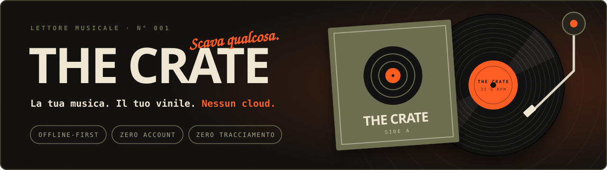

### La tua musica. Il tuo vinile. Nessun cloud.

**Un lettore musicale per le tue collezioni di MP3: veloce, bellissimo e completamente privato.**

`Offline-first` · `Zero account` · `Zero tracciamento` · `Zero abbonamenti`

---

## Perché The Crate?

Lo streaming ti ha dato milioni di brani, ma ti ha tolto la **tua** musica: abbonamenti che salgono, cataloghi che spariscono, algoritmi che decidono per te.

**The Crate fa l'opposto.** Prendi la tua collezione, la porti dentro l'app e *scavi* tra i tuoi dischi come in un negozio di vinili. Niente account, niente server, niente pubblicità. Solo tu e la tua musica.

> *"La cassa è vuota. Scava qualcosa."*

---

## ✨ Cosa ti conquisterà

### 🔒 Privacy totale, davvero
Nessun dato lascia il tuo dispositivo. I brani vengono copiati nell'archivio locale dell'app: **non c'è un server a cui inviarli**. Nessuna registrazione, nessuna analisi, nessun profilo.

### 📴 Funziona anche senza connessione
Metti il telefono in modalità aereo e continua ad ascoltare. Una volta importata, la tua libreria è **sempre con te**: in treno, in aereo, in montagna.

### 💿 Un'esperienza che sa di vinile
Il player a schermo intero non è un semplice pulsante play:

- 🎶 **Disco in rotazione** con solchi realistici e copertina sull'etichetta
- 🦾 **Braccio del giradischi** che si posa sul disco mentre suona e avanza lungo il brano
- 📼 **Dock stile cassetta** con bobine che girano e LED di stato
- 🌊 **Onda sonora interattiva**: trascina per spostarti nel brano
- 🏷️ **Titoli scorrevoli** come sull'etichetta di una vecchia cassetta

### 🗂️ La tua libreria, organizzata come vuoi
Importi una cartella e The Crate fa il resto, leggendo automaticamente i **tag ID3** e le **copertine incorporate**:

| Vista | Cosa ti offre |
|---|---|
| **Brani** | Tutta la collezione, ordinata e pronta |
| **Artisti** | Scopri discografie e numero di album |
| **Album** | Una parete di copertine leggermente inclinate, come dischi sfogliati in negozio |
| **Cartelle** | Naviga la struttura originale, con tanto di *divisori da cassa* con linguette scritte a mano |

### 🔎 Ricerca istantanea
Cerca per brano, artista, album o cartella mentre scrivi. Anche senza accenti, anche con errori di maiuscole. Le ricerche recenti restano a portata di tocco.

### 🎛️ Controllo totale dell'ascolto
- **Playlist illimitate** con riordino drag & drop (mouse e touch)
- **Coda dinamica**: "Riproduci dopo", "Aggiungi alla coda", riordina e rimuovi al volo
- **Shuffle** intelligente e **ripetizione** (tutto / singolo brano)
- **Timer di spegnimento**: 15, 30, 45, 60 minuti oppure *alla fine del brano*, perfetto per addormentarsi con la musica
- **Riprende da dove eri rimasto**: coda, brano e posizione vengono ricordati

---

## 🎨 Un design con una personalità

The Crate rifiuta l'aspetto "generico da app". L'estetica è quella di un **negozio di dischi indipendente**:

- Palette **nero inchiostro, carta crema, arancio segnale e oliva**
- Texture a **grana analogica** sull'intera interfaccia
- Tipografia espressiva con **Bricolage Grotesque**, **JetBrains Mono** e un tocco di scrittura a mano con **Caveat**
- Tema **Scuro**, **Chiaro carta** oppure **automatico** secondo il sistema
- Layout adattivo: **barra laterale su desktop**, **tab bar su telefono**

---

## 📱 Ovunque tu sia

| Piattaforma | Esperienza |
|---|---|
| 🖥️ **Desktop** | Barra laterale, scorciatoie da tastiera, **trascina una cartella** direttamente nella finestra |
| 📱 **Mobile** | Interfaccia pensata per il pollice, gesti, supporto alle aree sicure dello schermo |
| 🤖 **Android** | Integrazione nativa con controlli multimediali, notifica e copertina |
| 🎧 **Controlli di sistema** | Play, pausa, avanti, indietro e seek da schermata di blocco e cuffie (Media Session) |

### ⌨️ Scorciatoie da tastiera

| Tasto | Azione |
|---|---|
| `Spazio` | Play / Pausa |
| `→` / `←` | Avanti / indietro di 5 secondi |
| `Shift` + `→` / `←` | Brano successivo / precedente |
| `M` | Muto |
| `Esc` | Chiudi pannelli e player |

---

## 🎧 Formati supportati

`MP3` · `M4A` · `AAC` · `FLAC` · `OGG` · `OPUS` · `WAV`

Tag ID3 v2.2, v2.3 e v2.4 con supporto a UTF-8 e UTF-16, e se un file non ha tag, The Crate ricava titolo, artista e numero di traccia **dal nome del file**.

---

## 🚀 Inizia in 30 secondi

1. **Apri** The Crate
2. Tocca **Aggiungi cartella** (o trascina la tua cartella musicale sulla finestra)
3. Attendi lo *scavo*: l'importazione è parallela e veloce
4. **Premi play.** Fine.

Nessuna registrazione. Nessuna configurazione. Nessuna carta di credito.

---

## 🛠️ Sotto il cofano

Per chi ama sapere cosa c'è dentro:

- **Vanilla JavaScript**, nessun framework
- **IndexedDB** per archiviare brani, copertine e playlist localmente
- **Parser ID3 integrato** scritto da zero
- **Web Audio/Media Session API** per i controlli di sistema
- **Rendering canvas** per l'onda sonora
- **Accessibile**: navigazione da tastiera, ruoli ARIA, `prefers-reduced-motion` rispettato
- Ottimizzato per librerie grandi con `content-visibility` e importazione concorrente

---

## ❓ Domande frequenti

**I miei file vengono caricati online?**
No. Mai. Non esiste alcun backend.

**Dove vengono salvati i brani?**
Nell'archivio locale (IndexedDB) del tuo dispositivo, quindi restano disponibili offline.

**Posso eliminare tutto?**
Sì: *Impostazioni → Svuota la cassa*. Controllo completo, sempre.

**Costa qualcosa?**
Nessun abbonamento, nessun limite, nessuna pubblicità.

---

## Crediti

Idea, direzione creativa e design: **Simplegoat99**
Sviluppo realizzato con l'assistenza di **Claude** (Anthropic)

---

### Smetti di affittare la tua musica. Torna a possederla.

**🎞️ The Crate: scava, ascolta, ripeti.**

